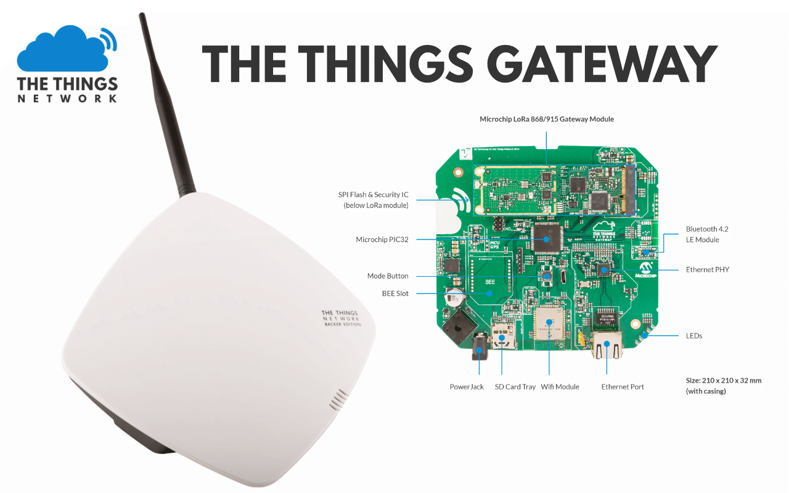

# The Things Gateway

This is a community fork of the firmware of The Things Gateway (the "Kickstarter gateway") by [The Things Products](https://github.com/TheThingsProducts/gateway). The original repository has not been updated since May 2023. This fork keeps the gateway working: it repairs faults that stopped it from connecting or made it reboot, and adds what is needed to use it with other network servers than The Things Network.

The work is done with the assistance of Large Language Models (Claude Code), on a dedicated Ubuntu machine with the original toolchain.

## What this fork changes

| Since | Change |
|---|---|
| 1.1.3 | WiFi access point is switched off when the gateway is connected; expired CA certificates replaced |
| 1.1.6 | Firmware updates over TLS work again (server name indication) |
| 1.2.28 | Semtech UDP packet forwarder (ChirpStack and other network servers), next to The Things Network |
| 1.2.28 | FOTA URL override: firmware updates from a server of your own |
| 1.2.32 | No more reboots caused by heap fragmentation |
| 1.2.35 | No more watchdog resets during start-up |
| 1.2.37 | Random TCP source ports, no more stalled TLS handshakes after a reboot |
| 1.2.38 | Web UI footer with the firmware version; UDP settings can be saved during start-up; public sync word with the built-in frequency plan |
| 1.2.39 | Status page: broker connection from the MQTT state, UDP packet counters, frequency plan in use, uptime as hh:mm:ss, smaller MQTT task stack (no reset after a network re-initialisation) |
| 1.2.40 | Info page names the connection to The Things Network "TTN" instead of "Broker" |

All changes per version are in the [changelog](changelog.md). Each release has detailed notes in [`releases/`](./releases).

## Installing

Firmware images (`firmware.hex` and `checksums`) are attached to the [GitHub releases](https://github.com/pe1mew/gateway/releases); they are not stored in the repository.

- **SD card:** copy both files to a folder `update` on a FAT32 formatted SD card, insert it in the gateway and power cycle. See [firmware/README.md](firmware/README.md).
- **Over the air:** a gateway that already runs this firmware (1.2.28 or later) updates itself from the server set as FOTA URL override on its Settings page. A server for this is [pe1mew/ttksgfotasrv](https://github.com/pe1mew/ttksgfotasrv).

## Where to buy

A list of resellers can be found [here](https://www.thethingsnetwork.org/the-things-products).

## Enclosure

Designs of the enclosure can be found in the [enclosure](./enclosure) directory. These designs are licensed under a [Creative Commons Attribution-ShareAlike 4.0 International License](http://creativecommons.org/licenses/by-sa/4.0/).

## Hardware

Designs of the hardware can be found in the [hardware](./hardware) directory. These designs are licensed under a [Creative Commons Attribution-ShareAlike 4.0 International License](http://creativecommons.org/licenses/by-sa/4.0/).

## Firmware

Firmware source code is located in the [firmware](./firmware) directory. Firmware source code is released under a [MIT License](https://opensource.org/licenses/MIT).

## Feature Requests, Bug Reports and Support

- For feature requests and bug reports on this firmware, create an [issue on GitHub](https://github.com/pe1mew/gateway/issues). See [contributing.md](contributing.md) for what to include and for how to contribute changes; the [code of conduct](code_of_conduct.md) applies.
- Community support on the [forum of The Things Network](https://www.thethingsnetwork.org/forum/c/gateways/the-things-gateway)
- The original firmware and hardware: [TheThingsProducts/gateway](https://github.com/TheThingsProducts/gateway)
